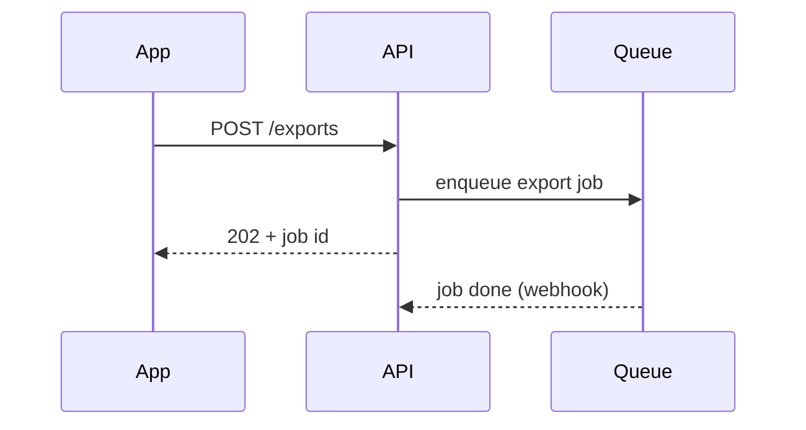

# PR Description Reference

## Summary visuals

Choose the smallest view that makes the point; place it next to the sentence it supports. Usually one, occasionally two.

**Pseudocode** for logic:
```text
on save(doc)
  if hash(doc) == cached.hash → return cached
  write doc
  cache ← result
```

**Call tree** for runtime flow:
```text
checkout
  priceCart
    applyCoupons
  reserveStock
  chargeCard
```

**Component tree** for UI structure (note state owners and package boundaries):
```text
<OrderPage>              routes/order.tsx
  useOrder(id)
  <OrderHeader>
  <LineItems>            packages/ui
```

**File tree** for refactors and moves:
```text
billing/
├── invoices/   creates and numbers invoices
├── payments/   talks to the payment provider
└── refunds/    new: refund rules and ledger entries
```

**Sequence diagram** for interactions across services:


**Shape diffs**: when the structure already existed, diff it instead of redrawing:
```diff
 checkout
   priceCart
+    applyLoyaltyPoints
   reserveStock
-  chargeCard
+  chargeCard (idempotency key)
```
Works the same for component trees, file trees, and state machines. Show the full block instead when most of it is new.

## Evidence tiers

| Tier | Form | When |
|---|---|---|
| Best | before/after screenshots or a short recording | visual changes; include narrow viewport if layout changed |
| Strong | the specific test that failed before and passes after; command output | logic, APIs, bugs |
| Okay | benchmark numbers with method (n, machine, command) | performance |
| Weak | "manually tested" with steps | only when nothing else is possible; list the steps |

Name tests exactly. For bugs, the failing-before test is the most convincing evidence.

## Risk vocabulary

- **Two-way door**: revert the PR and everything is as before (pure code, flagged features, additive endpoints).
- **One-way door**: reverting does not undo effects: destructive migrations, data backfills, deleting stored data, removing or renaming public API/events, sending emails or charges, changing IDs or URLs others store.
- **Blast radius** examples: one admin page; all logged-in users; every API consumer; mobile layout; billing; search ranking; build/CI for everyone.
- One-way doors need: deploy ordering, flag/kill switch, backfill plan, verification query, and what "rollback" means.

## Large PRs

- Give a reading order: "1. `schema.sql` 2. `repo.ts` 3. routes 4. UI".
- Mark generated or mechanical files so reviewers skip them.
- Offer a split: preparatory refactor → behaviour change → cleanup, as stacked PRs.

## Title patterns

| Change | Pattern | Example |
|---|---|---|
| feature | Add/Support/Allow … | `Allow admins to export invoices as CSV` |
| fix | Fix … when … | `Fix double charge when checkout is retried` |
| refactor | Extract/Move/Rename … | `Extract invoice numbering into its own module` |
| removal | Remove … | `Remove legacy v1 export endpoint` |
| perf | Speed up … / Reduce … | `Cut product page queries from 42 to 3` |
