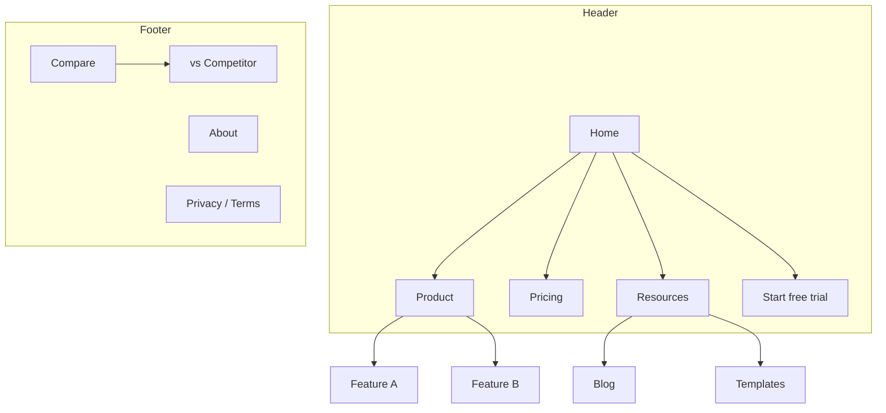

# Site Architecture

Use for new sites, restructures, migrations, and when an audit finds buried or orphaned pages.

## Deliverables
1. Page hierarchy as an ASCII tree with URLs at every node.
2. Visual sitemap (Mermaid `graph TD`, optional subgraphs for header/footer nav zones).
3. URL map table: Page · URL · Parent · Nav location · Priority (Critical/High/Medium/Low) · Target query.
4. Navigation spec: header, dropdown/mega menu, footer columns, breadcrumbs, sidebar (docs).
5. Internal linking plan: hubs, spokes, cross-section links, related-content modules.
6. Redirect map for any changed URL (old → new, 301).

## Depth and hierarchy
- Important pages ≤ 3 clicks from the homepage. If a key page is 4+ clicks deep, add links from hubs or nav.
- Prefer the shallowest tree that still gives a tidy menu. When one menu group grows past roughly fifteen to twenty entries, split it into a further level.

Typical shapes, shallowest first:
- **Local or small business** (one or two levels): services, locations, about and contact hang straight off the homepage; `/services/{name}`, `/locations/{city}`.
- **Content site or blog** (two or three levels): articles grouped under categories, plus newsletter and resources pages; `/blog/{slug}` with `/blog/category/{slug}`.
- **SaaS marketing site** (two or three levels): product or features, pricing, customers, integrations, comparisons, and a resources/blog area; `/features/{slug}`.
- **SaaS with a large content arm** (three or four levels): adds solutions pages split by role or industry (`/solutions/{segment}`) alongside resources and docs.
- **Online shop** (three or four levels): categories, collections and a sale area above individual products; either `/shop/{category}/{product}` or a flat `/products/{slug}`.
- **Documentation** (three or four levels): getting started, guides, API reference and changelog; `/docs/{section}/{page}`.

## Example: SaaS hierarchy
```
Homepage (/)
├── Product (/product)
│   ├── Feature A (/features/feature-a)
│   └── Feature B (/features/feature-b)
├── Solutions
│   ├── For agencies (/solutions/agencies)
│   └── For enterprise (/solutions/enterprise)
├── Pricing (/pricing)
├── Customers (/customers)
│   └── Case study (/customers/{company})
├── Integrations (/integrations)
│   └── Integration (/integrations/{tool})
├── Resources
│   ├── Blog (/blog) → posts (/blog/{slug})
│   ├── Templates (/templates/{slug})
│   └── Guides (/guides/{slug})
├── Compare (/compare)
│   ├── Brand vs Competitor (/vs/{competitor})
│   └── Competitor alternatives (/alternatives/{competitor})
├── Docs (/docs)
├── About (/about) · Careers (/careers) · Contact (/contact)
└── Legal: /privacy · /terms · /security
```

Mermaid version with nav zones:


Ecommerce: keep products reachable via category and collections; prefer `/products/{slug}` (one canonical URL even if a product sits in several categories) over deep category paths that create duplicates.

Docs: sidebar mirrors the folder tree; each page has prev/next links; versioned docs canonicalize to the current version.

## Navigation rules
- Header: 4-7 items, ordered by importance; primary CTA rightmost; logo → home. Mega menus max 3-4 columns, each with a heading.
- Footer columns: Product (features, pricing, integrations, changelog, security) · Resources (blog, templates, guides, case studies, docs) · Company (about, careers, contact, press) · Legal (privacy, terms, cookie settings). Comparison and alternatives hubs often live here.
- Breadcrumbs mirror the URL path; every segment except the current page is a link; add BreadcrumbList markup.
- Sidebar for docs and long resource sections; highlight the current page.
- Contextual links inside body copy carry the most relevance.
- Mobile: same links available (no content removed from mobile nav); hamburger with clear grouping.

## URL rules
1. Readable at a glance (`/features/invoicing`, not `/p?id=4471`).
2. Hyphens, lowercase, consistent trailing-slash policy (redirect the other form).
3. Path reflects hierarchy; one parent per section (don't mix `/features/x` and `/product/y`).
4. Short but descriptive (`/blog/landing-page-conversions`).
5. No dates in evergreen posts, no IDs where a slug works, no query parameters for content.
6. Never change a URL without a 301.

| Page type | Pattern |
|---|---|
| Feature | `/features/{name}` |
| Solution / persona | `/solutions/{segment}` or `/for/{audience}` |
| Pricing | `/pricing` |
| Blog post / category | `/blog/{slug}` / `/blog/category/{slug}` |
| Case study | `/customers/{slug}` |
| Docs | `/docs/{section}/{page}` |
| Landing page (paid) | `/lp/{slug}` (often noindex) |
| Comparison | `/vs/{competitor}` or `/compare/{a}-vs-{b}` |
| Alternatives | `/alternatives/{competitor}` |
| Integration | `/integrations/{tool}` |
| Template / tool | `/templates/{slug}`, `/tools/{slug}` |
| Location | `/locations/{city}` |

## Internal linking
| Type | Purpose |
|---|---|
| Navigational | Section movement (header, footer, sidebar, breadcrumbs) |
| Contextual | Relevance between related topics in body copy |
| Hub-and-spoke | Pillar links to every cluster page; each cluster page links back and to siblings where relevant |
| Cross-section | Feature ↔ case study ↔ blog post ↔ integration |

Rules: no orphan pages; descriptive anchors; ~5-10 contextual links per 1,000 words; money pages receive the most internal links; related-content module on posts; link new pages from ≥ 3 existing pages.

Audit checklist:
- [ ] Every page has ≥ 1 inbound internal link (crawl export: inlinks = 0 → orphan)
- [ ] No internal links to 3xx/4xx
- [ ] Anchors descriptive
- [ ] Priority pages are top by inlinks
- [ ] Breadcrumbs on all non-home pages
- [ ] Blog posts link to relevant product/feature pages

## Where to build new sections
Options, from strongest to weakest for search:
1. **Build it in the existing CMS.** The new pages inherit the domain's authority and internal links. Choose this whenever the current platform can handle the page type and the volume.
2. **Serve a subfolder from another system through a reverse proxy** (`example.com/blog` answered by a different app). Search engines treat it like the main site, provided the proxy is configured correctly (checklist below).
3. **Put it on a subdomain** (`blog.example.com`). Not penalised as such, but it needs its own sitemap and its own links, and in practice it ends up under-linked. Acceptable when a separate team or system owns it and you budget for the linking work.
4. **Launch a new domain.** It starts with no authority at all; only worth it for a brand that really is separate.

Reverse proxy checklist: canonicals, sitemap and Open Graph URLs use the main domain; asset paths routed; origin hostname not indexable (auth, IP allowlist or `X-Robots-Tag: noindex` only on the origin host); analytics/consent configured for one domain; test on staging first.

Platform choice considerations: who edits (designer, marketer, engineer), page volume and CMS item limits, server-side HTML, per-page indexation control, localization, ecommerce needs, migration cost later.
