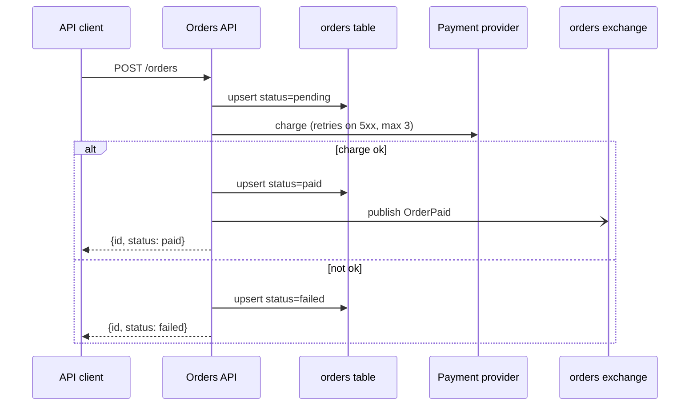

# Example: diagram what `POST /orders` does in a small repository

A real run on a five-file sample service. The spec is in [orders-service.json](orders-service.json).

**Brief:** "Draw what happens when an order is created, for the design review on Friday. It'll go in Confluence and in the repo README."

## 1. Decide type and destination

- The question is "what does this request touch?", so the main view is **architecture (container level, one flow)**. Its companion is a **sequence** diagram for the paid/failed branch.
- Destinations: Confluence can't render Mermaid, so it needs a PNG. The README is on GitHub, so a Mermaid fence works there. The review screen gets the HTML, whose hover tooltips show the evidence.

## 2. Pin the snapshot and trace

```text
$ git rev-parse --short HEAD && git status --short
871348a                      <- clean tree; commit goes in the title
$ rg -n "@api\.(get|post)|basic_consume|connect\(|httpx\.post|basic_publish" app worker
app/main.py:8:@api.post("/orders")
app/db.py:6:    with psycopg.connect(DSN) as conn:
app/payments.py:5:        r = httpx.post("https://psp.example/charges", ...)
app/events.py:5:    ch.basic_publish(exchange="orders", routing_key=name, ...)
worker/mailer.py:7:pika.BlockingConnection().channel().basic_consume("order-paid", on_message)
```

Reading `app/main.py:9-17` gave these facts:

| Fact | Evidence | Goes on |
|---|---|---|
| Order saved as `pending` first, then `paid` or `failed` | main.py:10,13,16 | edge api→db "upsert status" |
| Charge retried while the provider returns 5xx, up to 3 tries | payments.py:4-7 | edge label "retries 5xx x3" |
| `OrderPaid` is published only on success | main.py:12-14 | edge label "(only if paid)" |
| Worker consumes queue `order-paid` | mailer.py:7 | edge bus→mailer, marked `?` |
| Exchange→queue binding | not in the repo | note: Unknown |
| `result.ok` on an httpx response | main.py:12, payments.py:5 | note: possible bug |

Left out on purpose: the web storefront. Nothing in this repository calls the API, so the diagram shows a generic "API client" and the caption says the storefront isn't here.

## 3. Build and check

```text
$ python scripts/diagram_html.py orders-service.json -o orders.html --png orders.png --repo-root ../sample-repo
ERROR bad-source       node api: app/main.py:6-18 is outside the file (1-17)
6 nodes, 5 edges, 1 error(s), 0 warning(s); canvas 892x716px
```

The checker caught an off-by-one in the evidence. The cited range was fixed to `6-17`:

```text
$ python scripts/diagram_html.py orders-service.json -o orders.html --png orders.png --repo-root ../sample-repo
6 nodes, 5 edges, 0 error(s), 0 warning(s); canvas 892x716px
wrote orders.html
wrote orders.png
```

Layout choices (REFERENCE "Layout rules"):

- Main path left to right: client → API → exchange.
- Branch and store sit directly above and below their owner: the payment provider above the API, the `orders` table below it. Both edges are single straight segments.
- The mailer sits below the exchange it consumes from.
- No crossings. The column gaps were sized from the label lengths: "OrderPaid (only if paid)" made the API→exchange gap the widest.

The PNG was inspected: labels are readable, nothing sits on a line or a frame, and the three notes fit the canvas width.

## 4. Mermaid companion for the README



```text
$ python scripts/lint_mermaid.py README.md
0 error(s), 0 warning(s)
$ python scripts/extract_mermaid.py README.md --validate
OK   block 1 (line 10, sequence)
$ python scripts/extract_mermaid.py README.md --replace -o confluence.md --keep-source
wrote confluence.md with 1 image(s) in diagrams/
```

## 5. Hand-off

- `orders.html` (review screen), `orders.png` (Confluence), `orders-service.json` (source); the README fence plus `diagrams/readme_01_sequence_create_order.{mmd,png}`.
- Stated in the message: the commit traced, the storefront omitted for lack of evidence, the unknown binding, and the possible `result.ok` bug (worth a ticket before the review).
