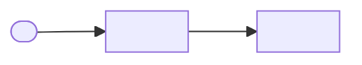

# <System or change name>: architecture

| | |
|---|---|
| Status | Draft / In review / Accepted |
| Owner | <name> |
| Reviewers | <names> |
| Last updated | <YYYY-MM-DD> |
| Code at | <repo> @ <commit> (repository-backed docs only) |

## 1. Context and goal

What problem this system or change solves, for whom, and what is out of scope. Two to five sentences.

## 2. System context

Who and what interacts with the system. Diagram: `diagrams/<doc>_01_flowchart_context.(mmd|png)`.

Caption: one sentence saying what the reader should notice.

## 3. Containers and responsibilities

| Container | Responsibility | Tech | Owner | Source |
|---|---|---|---|---|
| <Orders API> | <accepts and validates orders> | <FastAPI> | <team> | `<path:lines>` |

Diagram: containers view (`templates/starters/containers.mmd` shape, or `diagram_html.py` for a styled version).

## 4. Key flows

One sequence diagram per flow that matters (happy path plus the main failure). Under each one, list what happens on timeout, retry and partial failure.

## 5. Data

Entities and ownership (ER diagram), where data is stored, retention, and PII handling. Show data movement between systems as a data-flow diagram if it crosses team or trust boundaries.

## 6. Lifecycle / states

The state diagram for the main entity (order, job, account): every state, every transition with its trigger, and the terminal states.

## 7. Deployment and operations

Runtime topology (regions, clusters, managed services), scaling, network boundaries and ports, secrets, observability (logs, metrics, alerts), SLOs.

## 8. Decisions and alternatives

| Decision | Options considered | Chosen because | Revisit when |
|---|---|---|---|

## 9. Risks, unknowns and open questions

- Unknown: <fact that couldn't be confirmed from code or people, and what would confirm it>
- Risk: <what could go wrong, likelihood, mitigation>

## 10. Glossary

| Term | Meaning |
|---|---|
